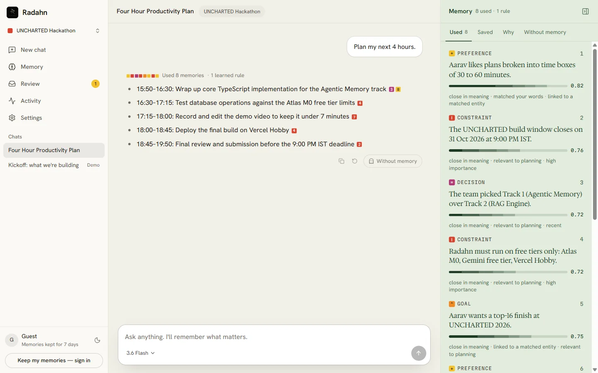
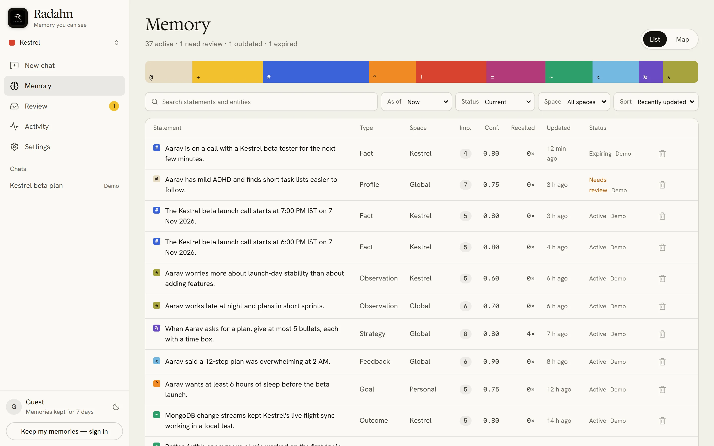
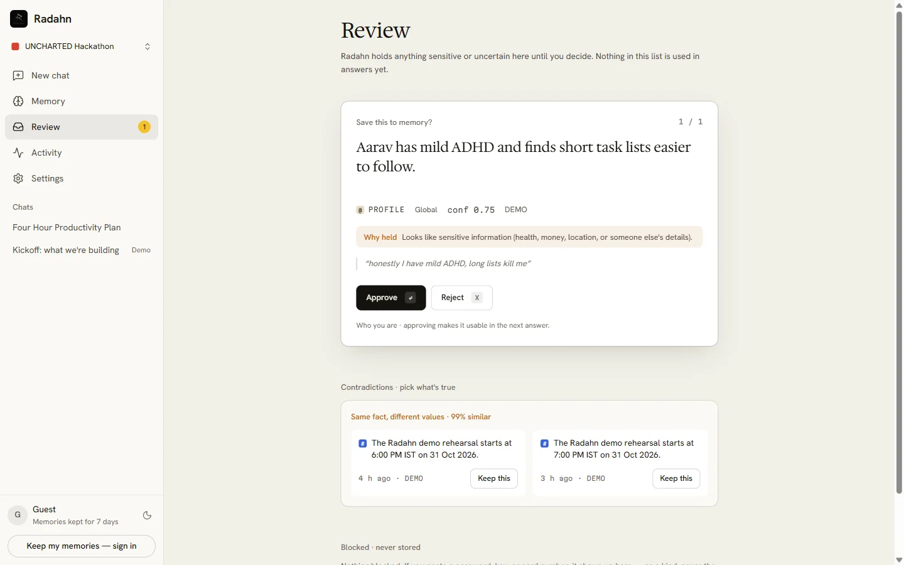

# Radahn

**A personal AI agent whose memory you can see, steer, and trust.**
Built on MongoDB Atlas · Next.js · Gemini and Groq

**Live:** https://radahn-ai.vercel.app · **How it works:** https://radahn-ai.vercel.app/how-it-works

Radahn remembers what matters (preferences, decisions, constraints, outcomes, feedback), uses it to change its next answer, and shows exactly *which* memory changed *what*, and *why*. Every reply cites the memories it used, the Memory panel shows the real scores behind each pick, and one click re-asks the same question **without memory** and shows the difference.

| Chat with the Memory panel | Memory | Review |
|---|---|---|
|  |  |  |

## How judges can test (no account needed)

1. Open https://radahn-ai.vercel.app → **Enter as guest**.
2. Click **Load demo memories** (a synthetic student, Aarav, building Kestrel, a flight-log app for drone pilots, a week before its public beta; labelled DEMO).
3. Ask **“Plan my next 4 hours.”** Watch the Memory panel: memories used, their score breakdowns (**Why** tab), and the learned behaviour that shapes the format. Click a citation square to open a memory. The model picker in the prompt bar switches between Gemini 3.6 Flash (default), 3.8 Flash, Flash-Lite and Groq-hosted models.
4. Click **Without memory** under the reply to see the word-level diff against a memory-free answer.
5. Try the difficult cases:
   - **Correction:** “Actually, the beta launch moved to 10 PM.” The reply shows *Corrected 9:00 PM → 10:00 PM*; the old memory becomes *outdated* and stays in history.
   - **Private info:** paste a fake key like `sk-test_aaaaaaaaaaaaaaaaaaaaaaaa`. It's redacted before the model sees it: “Not saved — looked like a credential”.
   - **Review:** the Review badge holds a sensitive memory until you approve or reject it.
   - **Unsure saves:** when Radahn isn't sure something is worth keeping, it asks above the prompt box: “Remember this? Remember / Don't”.
   - **Expiry:** open any memory → **Expire → In 2 minutes**. Recall stops then; MongoDB's TTL monitor deletes it shortly after.
   - **Forget:** the bin on any Memory row (or **Forget** on a memory) hard-deletes the statement and its vector, leaving a content-free tombstone event.
6. **Memory** lists every memory (filters, List/Map views, history per memory). Set **As of → Yesterday** to see what Radahn believed before later corrections (time travel). **Activity** shows live events from a change stream and lets you run **Reflect now**: duplicates merge, repeated feedback becomes a learned behaviour, each step streams in.
7. **Review** also lists **contradictions**: two live memories that can't both be true; keep one and the other is superseded with history.
8. **Connected agents (optional):** Settings → Connected agents → **Create key**, then run the shown command to give Claude Code (or any MCP client) scoped access to this memory. Whatever it saves appears live in Activity under its name.

## Agentic-memory requirements → Radahn

| Brief | Radahn |
|---|---|
| Persistent memory; decide what to remember, retrieve, update, correct, forget | Typed atomic memory units; extraction + privacy gate + reconcile (add / confirm / supersede / skip); lifecycle states; TTL expiry; hard forget |
| Memory visibly changes the next response | Inline citations, Memory lens, **Without memory** diff, learned strategies that change answer format |
| Inspect memory and explain why it was selected | Stored recall trace with per-channel ranks and score components; plain-language reasons; per-memory history and provenance |
| One difficult case | All five: correction, conflict, expiry, deletion, private info |
| MongoDB: documents with owner/type/content/source/timestamps/lifecycle | `memories` with `$jsonSchema` validation |
| Vector Search with filters | `$vectorSearch` pre-filtered on owner, space, status, type; fused with Atlas Search |
| TTL index for expiry | `purgeAt` TTL on memories, traces, rate limits |
| Change streams for live updates | `memory_events` change stream → SSE → write chips, Activity, Review badge |

## Architecture

One Next.js 16 app on Vercel (Mumbai), MongoDB Atlas M0 (Mumbai), Gemini via the AI SDK.

```
Browser ── /api/chat ──► pre-scan ─► recall (vector · lexical · temporal · graph → RRF → score → MMR)
   ▲                         │            │
   │                         ▼            ▼
   │                   chat model ◄─ system prompt (strategies · core · recalled · notices)
   │                   (3.6 Flash default; hedged to Groq GPT-OSS after 3.5 s)
   │                         │ streams reply with [[m3]] citations + memory tools
   │                         ▼
   │                   after(): extract (Flash-Lite) → gate → reconcile → transaction → memory_events
   └── /api/stream (SSE) ◄── change stream on memory_events
```

**MongoDB features used:** document model + schema validation, Atlas Vector Search with pre-filters, Atlas Search, TTL indexes, a partial unique index (one active value per fact), multi-document transactions, change streams, aggregation pipelines. Details: [docs/architecture.md](docs/architecture.md), [docs/memory-engine.md](docs/memory-engine.md).

**Scoring:** `final = 0.55·relevance(RRF) + 0.15·recency + 0.15·importance + 0.10·confidence + type boost`, threshold 0.35, MMR λ = 0.7, budget 8 units.

**Resilience:** quota-aware model routing across keys and providers (Gemini 3.6 Flash → Groq GPT-OSS 120B → 3.5 Flash-Lite → Groq Qwen 3.8 → 3.8 Flash; the user's pick in the prompt bar goes first). If the first model has produced nothing after 3.5 s a second one starts and the first to answer wins, so a quota-limited or hung model never stalls a reply. Groq models join only when `GROQ_API_KEY` is set.

**Agent access (MCP):** `POST /api/mcp` is a stateless Streamable-HTTP MCP server with `memory_search`, `memory_list`, `memory_save`, `memory_forget`. A key is scoped to the spaces you grant; owner, scope and the agent's name come from the verified key, never from tool arguments. Only a SHA-256 of each key is stored.

```bash
claude mcp add --transport http radahn https://radahn-ai.vercel.app/api/mcp --header "Authorization: Bearer <key from Settings>"
```

## Measured

Hosted run on production (Vercel + Atlas M0 + free-tier models), 31 Oct 2026, from [`evals/results.md`](evals/results.md): **20/20** live cases (write add / confirm / update-with-history / A→B→C correction, paraphrase confirms without duplicating, privacy no-store, cold-index plan recall, exact and temporal recall, ambiguous name ⇒ no delete, expired excluded, forget then recall nothing, diet memory beats a flood of unrelated "demo" memories), **31/31** deterministic checks (privacy gate, injection, reconcile, expiry grace), **0** secrets stored, write-op accuracy **1.0**, recall@5 **1.0**, recall p50 / p95 **566 / 571 ms** including the query embedding, first memory write **2.0 s** (p50) after the reply. Live samples are deliberately small on the free tier.

## Understand it in 10 minutes

[`docs/how-radahn-works.md`](docs/how-radahn-works.md) walks through one message end to end in plain language, and answers the common questions (how this differs from ChatGPT/Claude memory, why not just RAG, why MongoDB). Short answers: [`docs/qa-cheatsheet.md`](docs/qa-cheatsheet.md).

## Tech stack

Next.js 16 (App Router) · React 19 · TypeScript · Tailwind CSS v4 · AI SDK v7 + `@ai-sdk/google` + `@ai-sdk/groq` · Gemini 3.6 Flash / 3.8 Flash / 3.5 Flash-Lite · Groq GPT-OSS 120B / Qwen 3.8 · `gemini-embedding-2` (768-d) · react-markdown + remark-gfm · MongoDB Atlas M0 + Node driver v7 · Better Auth (guest + Google) · zod · Vitest · Vercel.

## Local setup

```bash
npm install
cp .env.example .env.local   # fill MONGODB_URI, GEMINI_API_KEYS, BETTER_AUTH_SECRET, CRON_SECRET (+ Google OAuth, GROQ_API_KEY optional)
npm run db:setup             # collections, validator, indexes, Atlas Search + Vector Search indexes
npm run dev
```

`npm run test` (unit), `npm run typecheck`, `npm run lint`, `npm run build`. `MEMORY_ENGINE=mock|real` switches between a fixture engine and the MongoDB engine.

## How we built it

Built in one day by a team of three with three coding agents: **Claude Code** (lead: architecture, app UI, routes, auth, streaming, realtime, deployment, integration), **Codex** (the memory engine: gate, recall, reconcile, reflection, evals) and, from the afternoon, **Antigravity** (public pages, landing screenshots, Review / Activity / Settings polish, deck), working in parallel against shared TypeScript contracts and merged by Claude after CI. The humans set direction, made product calls, handled accounts and keys, wrote the demo persona, and reviewed and tested the result. The planning docs in [docs/](docs/) record every decision.

## Research lineage

Hindsight (typed units, retain/recall/reflect, multi-channel recall), Hermes Agent (bounded core memory, write approval), IHMT-MEMORY (supersede-not-delete, clarify on ambiguity), Generative Agents (recency × importance × relevance, reflection), Mem0 (reconcile ops), MemGPT/Letta (core vs archival, sleep-time consolidation), Zep/Graphiti (bi-temporal validity). See [/how-it-works](https://radahn-ai.vercel.app/how-it-works).

## Limitations

Free tiers only (Gemini and Groq free-tier quotas are small; Google may use free-tier prompts to improve its products, so don't enter real secrets). Extraction is an LLM call and can miss or over-remember; everything it writes is visible and reversible. The reflection profile step depends on the model's output and passes most, not all, hosted self-test runs. The optional Voyage reranker in the design was not built. Guest memories last 7 days.

## Attribution

Logo by the team. Fonts: Hedvig Letters Serif, Hanken Grotesk, Martian Mono (Google Fonts, OFL). Icons: lucide (ISC). Visual references: Griffin, LocalCan, Teak, Stanley Whitney's *How High the Moon* (inspiration only; no assets copied).
