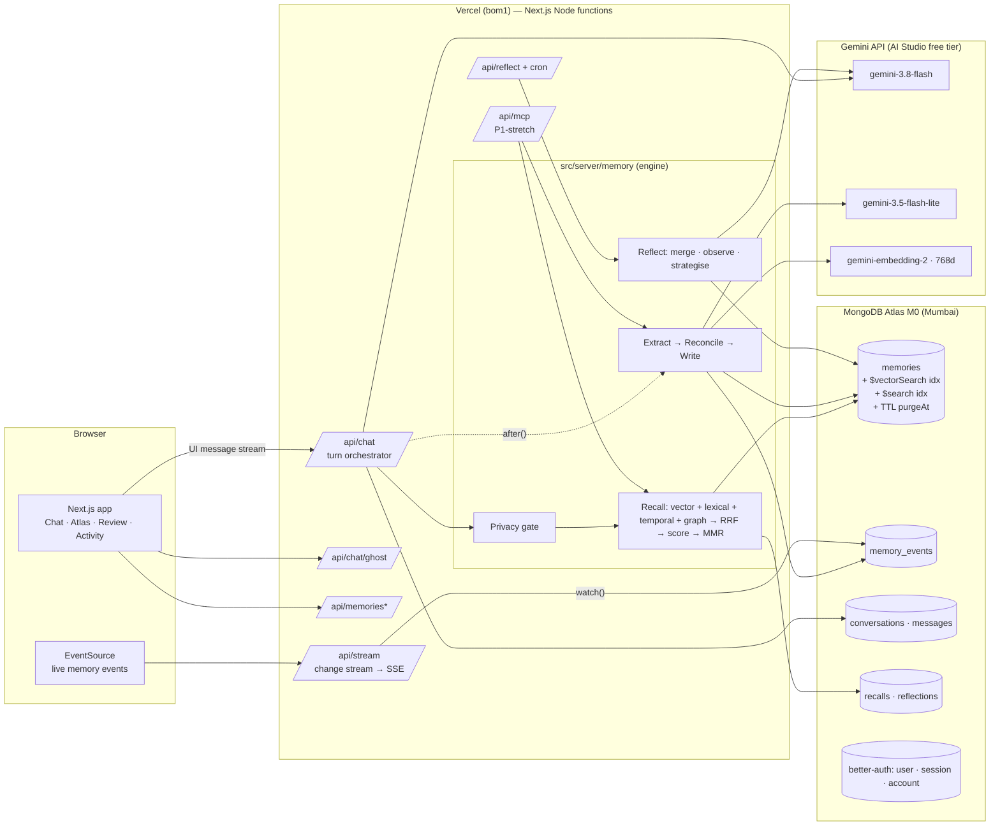
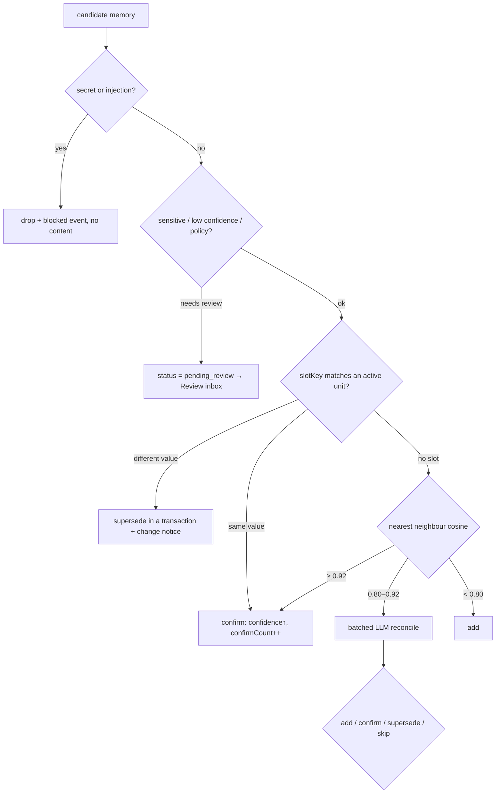
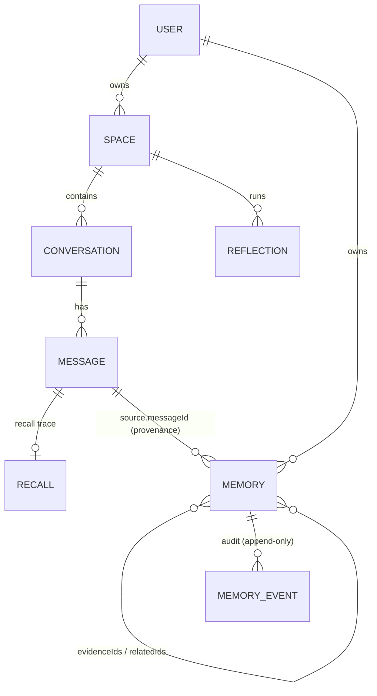

# Radahn — Architecture

> System view for builders and for judges ("explain your architecture, data model, and choices", per the challenge PDF). Details: [TRD.md](TRD.md), [memory-engine.md](memory-engine.md).

## 1. System overview



One deployable (Next.js on Vercel), one database (Atlas), one model provider (Gemini). No queues, no workers, no second store: post-response work runs in `after()`, scheduled work in Vercel cron, realtime through change streams.

## 2. A chat turn, end to end

```mermaid
sequenceDiagram
  autonumber
  participant U as Browser
  participant C as /api/chat
  participant E as Engine
  participant M as MongoDB
  participant G as Gemini
  U->>C: user message (+conversationId, spaceId)
  C->>E: preScan(message) — redact secrets
  E-->>U: data-redaction (if any)
  C->>E: recall(query, owner, space)
  par channels
    E->>G: embed(query, 768d)
    E->>M: $vectorSearch (pre-filter owner/space/status)
    E->>M: $search lexical
    E->>M: temporal window (if time words)
  end
  E->>M: graph-lite: units sharing entities of top-3
  E->>E: RRF → score → MMR → budget → notices
  E->>M: insert recall trace
  C-->>U: data-recall (picked units, scores, reasons)
  C->>G: streamText(system = rules + strategies + core + recalled + notices, tools)
  G-->>U: tokens with [[m3]] citations (+ tool chips)
  Note over C: response closes; after() continues
  C->>M: persist messages (redacted)
  C->>E: extract (Flash-Lite, JSON) → gate → embed → reconcile
  E->>M: transaction: insert/supersede/confirm + memory_events
  M-->>U: change stream → SSE → "+2 remembered · 1 updated · 1 needs review"
  E->>E: unitsSinceReflection ≥ 8 → reflect (after())
```

## 3. Write path decisions



## 4. Data model at a glance



Modelling choices (talking points):
- **Embed vs reference.** A memory's provenance (`source`) and stats are embedded (always read together); versions, evidence, and related units are references (independent lifecycles, many-to-many).
- **Short-term vs long-term memory** map to `messages` and `memories`, exactly as MongoDB's "Build AI Agents" guide describes, but long-term memory is atomic units rather than one profile document per user, so each unit can carry its own lifecycle, vector, and provenance.
- **`spaceKey` string with a `global` sentinel** keeps vector pre-filters to simple `$in` on strings.
- **Append-only `memory_events`** makes the audit trail, the live feed, and "what happened to this memory" one collection, and it is the only thing the change stream watches.

## 5. MongoDB feature map (what judges should hear)

| Feature | Where | Why it matters here |
|---|---|---|
| Document model + `$jsonSchema` validation | `memories` | Structured fields, text, and vectors in one document, with required lifecycle fields enforced |
| Atlas **Vector Search** with pre-filters | Recall channel 1, reconcile neighbours | Semantic recall scoped by user, space, status, type |
| Atlas **Search** (lexical) | Recall channel 2 | Exact names/codes; hybrid with vectors via RRF |
| **TTL index** on `purgeAt` | Expired/rejected units, recall traces, rate limits | Time-based forgetting without cron code |
| **Partial unique index** `{ownerId, spaceKey, slotKey}` where active | Reconcile | Database-guaranteed "one current truth per slot", safe with multiple writers |
| **Multi-document transactions** | Supersede, reflection merges, guest→Google migration | Never half-corrected memory |
| **Change streams** | `/api/stream` | Live UI across tabs, devices, and external agents |
| **Aggregation pipelines** | Insights, recall history, Atlas facets | Counts by type over time, hit rate, corrections |
| Classic `$text` index | Chat history search | Keeps Atlas Search index budget (M0: 3) for memory |

## 6. Deployment topology

- Vercel project (Hobby), production branch `main`, function region `bom1`. Atlas M0 in AWS `ap-south-1` (Mumbai) → single-digit-ms DB latency.
- Atlas network access: `0.0.0.0/0` (Vercel has dynamic egress IPs), protected by a strong DB-user password and least-privilege role (`readWrite` on `radahn` and `radahn_eval`).
- Preview deployments per PR (guest auth works on previews; Google sign-in only on prod + localhost).
- Daily crons for maintenance and reflection.

## 7. Failure modes and fallbacks

| Failure | Behaviour |
|---|---|
| Gemini 429 / 5xx | Rotate key → next model in chain → error card with retry. Model actually used is shown. |
| Embedding call fails | Recall runs lexical + temporal + graph only; reconcile defaults to `add` with `needsEmbedding: true`, backfilled by maintenance cron. |
| Vector index not queryable yet | `exact: true` brute-force search (fine for ≤ a few thousand units). |
| Change stream closes / unsupported | Client reconnects with `Last-Event-ID`; server falls back to polling `memory_events`. |
| `after()` work dies mid-way | Writes are idempotent per `(messageId, candidate hash)`; maintenance cron retries messages with `writeSummary` missing. |
| Two writers race on a slot | Unique-index violation → retried as supersede. |

## 8. If this had to scale (Q&A answers, from the MongoDB AI Data Strategy videos)

- **Storage:** shard `memories` on `{ownerId: 'hashed'}`; every query is owner-scoped, so it targets a single shard.
- **Search compute:** dedicated **Search Nodes** so vector/lexical queries scale separately from writes.
- **Vector cost:** scalar/binary **quantization** of the 768-d vectors (Atlas automatic quantization) to cut index memory.
- **Embeddings:** switch to Atlas **automated embedding** with Voyage AI on an M10+ cluster, removing the embed calls from the app.
- **Governance:** RBAC per service, encryption at rest/in transit, auditing; `memory_events` already gives an application-level audit trail for "why did the agent do that?".
